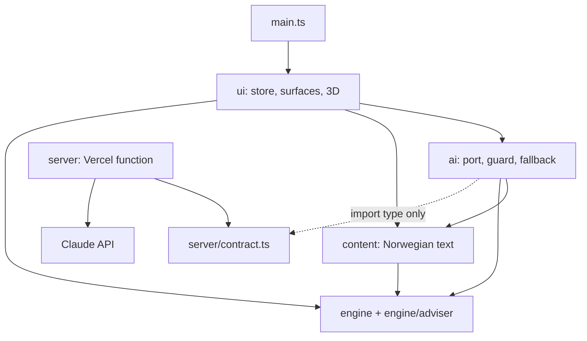
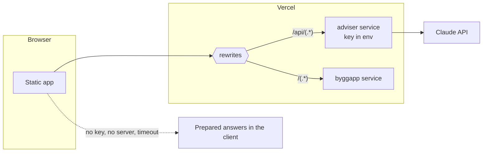

# Architecture Spine — Fra tomt til tak

## Design Paradigm

**Functional core, imperative shell, with ports and adapters at the AI edge.** All numbers come from a pure core. Everything with an effect (DOM, WebGL, network, clock, randomness) lives in a thin shell around it. The language model sits behind one port and can be missing.

| Layer | Directory | May do |
|---|---|---|
| **Engine** (core) | `ByggAPP/src/engine` | Calculate. No effects. |
| **Adviser rules** (core) | `ByggAPP/src/engine/adviser` | Suggestions, warnings, recommendations, as data. |
| **Content** | `ByggAPP/src/content` | Norwegian text, prepared answers, formatting of facts. |
| **AI layer** (adapter) | `ByggAPP/src/ai`, `ByggAPP/server` | Ask the language model for text. Fall back. |
| **View** (shell) | `ByggAPP/src/ui`, `ByggAPP/src/main.ts` | Hold state, render, draw 3D, run the clock. |



Arrows are the only allowed imports. `engine` imports nothing outside itself. `server` imports nothing from `src`. No code imports from `02. Arkiv`.

## Invariants & Rules

### AD-1 — The engine is pure and deterministic [ADOPTED]

- **Binds:** FR-30, NFR-8, all of `src/engine`
- **Prevents:** Results that differ between runs, and tests that need a browser.
- **Rule:** `src/engine` has no DOM, `three`, `fetch`, `Date`, `Math.random`, `localStorage` or `process`, and no imports from `ui`, `ai` or `content`. A test scans the folder and fails on any of these. The same seed, plan and decisions give the same result.

### AD-2 — One seeded stream, drawn once into a fixed table [ADOPTED]

- **Binds:** R15–R17, R25, FR-19, FR-30
- **Prevents:** A choice shifting later draws. v0.5 draws inside `step` and `raise`, so its stream depends on play.
- **Rule:** `drawAll(seed)` runs the mulberry32 generator from v0.5 once at start and returns a `Draws` value with fixed slots, in R15 order: 5 deviations, 4 known risks, 6 reliability draws, then slots appended for later rules. Slots never move. Rules read slots by index; nothing else generates random numbers. An avoided risk keeps its slot. New draws go after the last slot. Engine functions take `Draws`, not a seed, so tests inject the values in the worked examples. The shell picks the seed; `?seed=` sets it for tests and demos.

### AD-3 — Integer units, rounded once per rule [ADOPTED]

- **Binds:** Rules §0, FR-24, FR-31
- **Prevents:** 8.5 rounding to 8, and a budget bridge that does not sum.
- **Rule:** Money is whole NOK, probability is whole percent, and durations are whole weeks at rule outputs with tenths inside a rule. All division that rounds goes through one `roundDiv` helper in `engine/units.ts`; ⌊ ⌋ cases use `floorDiv`. MNOK with decimals exists only in `src/content` formatting. Each rule rounds at its end and not before.

### AD-4 — The building-block model replaces the fixed scenario [ADOPTED]

- **Binds:** FR-3–FR-13, R1–R14
- **Prevents:** Two models of truth, or stories adapting the old hours/crew/rate model to fit the rules.
- **Rule:** The project is derived from `Concept` (floors, system) by R1–R14. The six main parts are the only work breakdown. Targets are derived by R14, not stored. `engine/scenario.ts`, `game.ts`, `simulate.ts`, `events.ts`, `chapters.ts`, `advisor.ts` and their tests are removed, not adapted; see the disposition table. New code never imports them. Seed hunting (`findStory`) is removed: targets are judged in bands (R29).

### AD-5 — Every parameter lives in one data file

- **Binds:** FR-31, S1–S35, R10
- **Prevents:** Magic numbers in rules, so the group can change an estimate without touching code.
- **Rule:** `engine/data/params.ts` holds every S-value keyed by its S-id, and the risk table (R10). `engine/data/references.ts` holds the citable projects from the addendum §2, and only those. A numeric literal in a rule function is a defect, except 0, 1 and 100.

### AD-6 — A run is a pure fold over six parts, and events are fixed at approval

- **Binds:** R16–R24, FR-18–FR-22, FR-34
- **Prevents:** A weekly tick with its own state, forecasts by cloning mutable state, and event sets that shift with decisions.
- **Rule:** `selectEvents(plan, draws)` is decided at approval and depends on nothing else (R17–R19). `replay(plan, draws, policy, upTo?)` folds over the parts in order: apply events at the part's start, ask `policy` for each decision, then compute duration and cost. It returns a `Run` with start and finish per part, cost and events. The forecast (R24) is `replay` with the events cut off after the last decided one. Weeks are playback: the shell moves a cursor over the `Run`, `timelineAt(run, week)` gives progress, and the cursor stops at the next undecided event. This replaces the v0.5 `step` loop; only its concepts and values carry over.

### AD-7 — One state, changed only by commands

- **Binds:** All surfaces, FR-6, FR-13, FR-34
- **Prevents:** Copies of figures in the view that drift from the model, and mutation from click handlers.
- **Rule:** `Playthrough` (id, seed, difficulty, stage, draft plan, approved plan, log) is immutable data. `reduce(state, command)` in `engine/playthrough.ts` is the only way to change it, and the store in `ui/store.ts` holds the current value. After approval the plan is frozen and `reduce` refuses plan commands. Stage 1 navigation, playback week, adviser messages and the live flag are `UiState` in the store and never feed a calculation. Figures, warnings, suggestions, forecasts and the debrief are computed by `derive(state)` and never stored. Wall-clock time arrives as `at` on the command and is only written to the log.

### AD-8 — The decision log is the single record

- **Binds:** FR-15, FR-23–FR-29, FR-38, R26–R30
- **Prevents:** The debrief keeping its own counters, or a decision that shows in one place and not another.
- **Rule:** `log` is append-only and written only by `reduce`. Stage 2 decisions exist nowhere else: `replay` reads them from the log. Each entry has time, step or event id, the choice, the adviser's recommendation and any warning. Stage 1 is logged at commit points (leaving a step, using a suggestion, approval), not per slider tick. A warning is logged once, when it first fires. The debrief is a pure function of `plan`, `draws` and `log`.

### AD-9 — Every "what if" is a replay

- **Binds:** FR-22, FR-24, FR-26, FR-28, FR-38, R25–R27, R30
- **Prevents:** A second calculation of cost in the debrief that disagrees with the run.
- **Rule:** The AI path, bridge runs, "right" tests and impact ranking each call `replay` with a different plan or `policy`. The four bridge causes must sum exactly to final minus target, and a test asserts it for many seeds. [ASSUMPTION] When an R30 swap of a stage 1 choice changes the event set, stage 2 decisions are kept for events that still occur and the AI recommendation handles new ones.

### AD-10 — Adviser rules are engine code and return data

- **Binds:** FR-9, FR-14, FR-15, FR-20, FR-22, FR-33, FR-36, R4, R9, R12, R25, R30
- **Prevents:** Warnings that depend on the language model, and logic mixed with Norwegian sentences as in v0.5 `advisor.ts`.
- **Rule:** `engine/adviser` returns records such as `{ kind, ruleId, subject, values, citation? }` and no text. Same input, same output. A citation can only point into `references.ts`. Suggestions are applied only by a command the student triggers (`Bruk forslaget`); no adviser code issues commands.

### AD-11 — The language model only explains

- **Binds:** FR-17, PRD §6
- **Prevents:** A model reply changing the plan or the numbers.
- **Rule:** `src/ai` returns text to the view and has no access to `dispatch` or `reduce`. A reply goes into `UiState` adviser messages and is never parsed into a command, logged as a decision or fed to the engine. The server has no route that takes or returns state changes.

### AD-12 — Prepared answers are the floor, and replies pass a figure guard

- **Binds:** FR-16, FR-17, NFR-1
- **Prevents:** A broken adviser without a key, and model figures that differ from the engine.
- **Rule:** Every question, chip or free text, always gets an answer, with no error shown. `ai/ask.ts` is the one entry point: it returns a model reply, or `nearestPrepared(question, step, facts)` marked `Forberedt svar`. That fallback runs in the client, so it works with no server. Prepared answers are templates filled from engine facts, never literal figures. Before display, `guard(reply, facts)` checks that every number in the reply equals a value in the approved facts; a miss means fallback. Prepared answers pass the same guard in a test. Replies are not streamed to the browser, because a guard cannot take back text already shown.

### AD-13 — The client never holds the key; one small server function does

- **Binds:** NFR-1, NFR-2, FR-17
- **Prevents:** A key in the bundle, the SDK in the client, and client and server drifting apart.
- **Rule:** `ByggAPP/server` is its own package and Vercel service with its own `package.json`. It is the only code that reads `ANTHROPIC_API_KEY` or imports `@anthropic-ai/sdk`. TypeScript stays `~5.9.3` there, because Vercel's Node builder cannot use TypeScript 7 (build log 2026-11-03). `server/contract.ts` is the source of the contract below; the client uses `import type` only. Code worth keeping from the archive is copied in and adapted, never imported. The status route reports `live: false` with no key, and the POST route answers 503.

```ts
// GET /api/adviser/status -> { live: boolean }
// POST /api/adviser
interface AdviserRequest {
  v: 1;
  playthroughId: string;
  step: string;                                  // current surface
  question: string;                              // max 500 chars
  history: { role: 'user' | 'adviser'; text: string }[]; // max 6
  facts: { id: string; label: string; value: string }[]; // the approved facts
}
interface AdviserReply { answer: string; basis: string; onTopic: boolean } // 200 only
// Any other status (400, 405, 413, 429, 502, 503) means: use the prepared answer.
```

### AD-14 — Fixed budget per call and per playthrough

- **Binds:** PRD §6, FR-17, EXPERIENCE (adviser thinking)
- **Prevents:** Open-ended cost and a student left waiting.
- **Rule:** The client allows 20 calls per playthrough [ASSUMPTION, from PRD §6], then uses prepared answers. It aborts at 8 s. The server sets the SDK to a 7 s timeout with `maxRetries: 0`, rejects bodies over 32 KB, and applies an in-memory limit per playthrough id and per `x-forwarded-for` IP. That limit is best effort, since each function instance has its own memory; the hard cap is a spend limit in the Claude Console. The server does not log questions or facts. The client asks the status route once per playthrough, so the no-key path never waits.

### AD-15 — 3D reads state and never changes it [ADOPTED]

- **Binds:** FR-6, FR-18, NFR-4, NFR-5
- **Prevents:** Game logic in the scene, and a playthrough that fails without WebGL.
- **Rule:** `SceneState` is computed by a pure `sceneState(view)` and is the view's only input. `View3d` is `update(SceneState)`, `setActive(on)`, `dispose()`; it has no callbacks to the shell and imports no engine types beyond what `SceneState` names. Everything animated is presentation time. `three` is loaded lazily, so a failed load or missing WebGL gives the static illustration and the run continues. `describeScene` in `src/content` gives the text alternative from the same `SceneState`. The v0.5 automatic quality drop stays. No walking, no camera needed to play.

### AD-16 — UI strings are Norwegian and live in one place

- **Binds:** NFR-6, NFR-9
- **Prevents:** Text scattered through logic, and unexplained terms.
- **Rule:** Student-facing text, including term explanations and prepared answers, lives only in `src/content`. Surfaces take it from there; engine and adviser return codes. Code, comments and documentation are English. Rule, parameter and event ids never show in the UI, except source names in *Grunnlag*.

### AD-17 — Vanilla TypeScript renderers, one mounted form [ADOPTED]

- **Binds:** All of `src/ui`, NFR-5
- **Prevents:** Lost focus and caret on every recompute, and framework creep.
- **Rule:** No UI framework. As in v0.5, surfaces are pure functions from view data to HTML strings, written through `setHtml`, with one delegated listener mapping `data-action` to commands. Input controls are mounted once per step and are not re-rendered while the step is open; only output regions (top bar, consequence table, Gantt, warnings) re-render. The app starts through `mountApp(root, deps)`, with the 3D factory, adviser port, clock and seed source in `deps`. Top-level side effects as in v0.5 `main.ts` are gone. Controls are hand-built in Fluent style, with `DESIGN.md` tokens as CSS custom properties.

### AD-18 — Rules are tests, and rule ids are traceable [ADOPTED]

- **Binds:** FR-31, SM-3, NFR-8
- **Prevents:** Implementation drifting from the group's hand-checked rules.
- **Rule:** Each worked example in rules §4 runs in `engine/worked-examples.test.ts` with values copied from the document and `Draws` injected. A failing example is fixed in the code or, if the rule changes, in the document first. The function implementing a rule has a doc comment starting with its id (`/** R16: … */`), and the test title starts with the id. A test reads `simulation-rules.md` and fails if an `R` id has no test.

### AD-19 — Three test layers

- **Binds:** NFR-8, NFR-10, SM-3, instructor feedback
- **Prevents:** Logic tested through the DOM, and flows tested nowhere.
- **Rule:** (1) Vitest in Node for `engine`, `content`, `ai` with a fake `fetch`, and `server` with an injected client; no network and no key. (2) DOM tests under jsdom, set per file, that drive click flows through `mountApp` with a fake `View3d` and adviser port, one per UX flow, including the no-key path. (3) A manual test plan in `ByggAPP/docs/manual-test-plan.md` [ASSUMPTION] for the 3D view, free-text answers and a full playthrough, with results recorded per round (NFR-10). The purity scan from AD-1 runs in layer 1.

### AD-20 — Vercel is the one deployment, and local needs nothing

- **Binds:** NFR-1, NFR-2, SM-4
- **Prevents:** A README that needs a key, and two hosting paths.
- **Rule:** `vercel.json` has the services `byggapp` (root `ByggAPP`) and `adviser` (root `ByggAPP/server`, entrypoint `vercel.ts`) [ASSUMPTION until the first deploy]. `/api/(.*)` is rewritten to `adviser` before the catch-all; Vercel keeps the path, so routes include `/api`. `npm install && npm run dev` in `ByggAPP` runs the full game on prepared answers. `ByggAPP/server/.env.example` lists `ANTHROPIC_API_KEY` and `ADVISER_MODEL`, with no values. The key is set in Vercel for Production only. With a local key, `npm start` in `server` runs the same handler and the Vite dev proxy forwards `/api` to it. GitHub Pages is dropped: remove `ByggAPP/.github` and `BASE_PATH`.

## Consistency Conventions

| Concern | Convention |
|---|---|
| Ids | Rules `R16`, parameters `S14`, events `E1`–`E10`, as in the rules document. Main parts `permit`, `ground`, `frame`, `envelope`, `interior`, `handover`. Systems `cast`, `precast`, `steel`, `clt`. Responses `accept`, `reduce`, `transfer`, `avoid`. |
| Files | camelCase `.ts`, test beside the code as `name.test.ts`. One rule group per engine file. |
| Commands | Plain objects with `type` in camelCase (`setFloors`, `approvePlan`, `decideEvent`) and `at`. |
| Display numbers | Only `src/content/format.ts` formats: MNOK with 1 decimal and a comma, `uke 67`. Tests compare integers in the engine, text at the surface. |
| Bands | R29 labels only: *På mål*, *Litt over*, *Klart over*. No pass or fail wording. |
| Errors | The engine throws only on programmer error (an unknown id). Bad input is a warning record, not an exception. The student never sees an error message. |
| Decision-log file | One UTF-8 CSV with BOM and `;` separators, one row per entry, built by a pure function. |
| Privacy | No analytics, cookies or storage. A leave-page prompt, no resume. Free-text questions go to the server; nothing else leaves the browser. |
| UX authority | `EXPERIENCE.md` and `DESIGN.md` bind behaviour and look. The spine decides only where they name architecture. |

## Stack

| Name | Version |
|---|---|
| TypeScript, app | 7.0.2 |
| TypeScript, server | ~5.9.3 |
| Vite | 8.3.5 |
| Vitest | 5.0.5 |
| three | 0.186.1 |
| @types/three | ^0.186.0 |
| jsdom [ASSUMPTION] | 31.0.0 |
| @anthropic-ai/sdk | ^1.6.0 |
| Claude model [ASSUMPTION] | `claude-opus-5-5`, effort `low`, via `ADVISER_MODEL` |
| Node, functions and CI [ASSUMPTION] | 22.x |
| Hosting | Vercel services |

## Structural Seed

```text
ByggAPP/
  src/
    engine/
      data/        params.ts, references.ts
      adviser/     suggest, warn, recommend, closeness
      debrief/     bridge, trust, goals, bands, impact
      units, draws, concept, risks, targets, events, replay, playthrough, derive
    content/       no.ts, terms, prepared answers, facts, describeScene, format
    ai/            ask, client, guard, nearest
    ui/            store, dom (setHtml), frame, adviserWindow, gantt
      surfaces/    start, meeting, concept, schedule, risk, present, execution, debrief
      scene/       view3d, sceneState, world, props, cast
    main.ts        mountApp(root, realDeps)
  server/          own package: contract, handler, ratelimit, prompt, claude, vercel, start
  docs/            manual-test-plan.md
```

**What happens to the v0.5 code**

| Code | Fate |
|---|---|
| `engine/scenario, game, simulate, events, chapters, advisor` + tests | **Remove.** Keep mulberry32, the reliability values and the idea of the fork record. |
| `ui/story, scenes, play, hud, budgetLines`, `ui/tabs/*`, `scene/walk` + tests | **Remove.** Reuse text and layout of `renderFork` and `renderFinal` when writing path comparison and debrief. |
| `main.ts` | **Rewrite** as `mountApp`. Keep `setHtml` and delegated clicks. `?uke`, `?scene` give way to `?seed`. |
| `ui/view3d.ts`, `scene/visuals.ts` | **Adapt.** Parametric building from floors and footprint, site-office scene, no player, no hooks. |
| `scene/world, props, cast`, `scene/challenge` | **Adapt** the first three. Remove `challenge` unless a story re-keys it to E1–E10. |
| `ui/gantt.ts` | **Adapt** to six parts, plan-against-actual overlay. |
| `ui/format.ts` | **Keep**, move to `content`. |
| `styles.css` | **Replace** with `DESIGN.md` tokens; the glass HUD goes. |
| `assets/icons`, `G115_*.md`, `.docs` | **Keep** what is used. Rename the package and page title. |



| Environment | Key | Adviser free text |
|---|---|---|
| Local, `npm run dev` | none | Prepared answers |
| Local, plus `npm start` in `server` | `server/.env` | Language model |
| Vercel Preview | none | Prepared answers |
| Vercel Production | Vercel env | Language model, then prepared |

## Capability → Architecture Map

| Capability | Lives in | Governed by |
|---|---|---|
| FR-1, FR-2 Start, meeting | `playthrough`, `surfaces/start, meeting` | AD-2, AD-7 |
| FR-3–FR-6 Concept | `concept`, `targets`, `surfaces/concept`, `scene` | AD-3, AD-4, AD-15 |
| FR-7–FR-9, FR-32 Schedule, milestones | `concept`, `adviser/suggest`, `surfaces/schedule`, `gantt` | AD-4, AD-10 |
| FR-10–FR-12, FR-36 Risk, reserve | `risks`, `adviser/warn`, `surfaces/risk` | AD-5, AD-10 |
| FR-13 Approve | `playthrough`, `surfaces/present` | AD-7, AD-8 |
| FR-14–FR-16 Adviser rules, chips | `engine/adviser`, `content`, `adviserWindow` | AD-10, AD-12 |
| FR-17 Free text | `ai`, `server` | AD-11–AD-14 |
| FR-18–FR-22, FR-33–FR-35 Execution | `events`, `replay`, `adviser/recommend`, `surfaces/execution` | AD-2, AD-6, AD-9 |
| FR-23–FR-29, FR-38 Debrief | `engine/debrief`, `surfaces/debrief` | AD-8, AD-9 |
| FR-30, FR-31 Simulation model | `engine`, `worked-examples.test.ts` | AD-1, AD-2, AD-18 |
| FR-37 Assignment trace | PRD §13 | No code |
| NFR-1, NFR-2 | `ai`, `server`, deploy | AD-12, AD-13, AD-20 |
| NFR-3, NFR-7 Session, desktop | `surfaces`, frame | UX spine |
| NFR-4, NFR-5 3D, accessibility | `scene`, `content` | AD-15, AD-17 |
| NFR-6, NFR-9 Language | `content` | AD-16 |
| NFR-8, NFR-10 Testing | All tests, `docs` | AD-18, AD-19 |

## Open Questions

1. **R24 forecast shows the truth too early.** Example (c) forecasts with actual durations for parts not yet started, so the top bar shows the real overrun from week 0 of stage 2 and stands still between events. Keep it, or use estimates for unstarted parts? The second option changes example (c). Implemented as written until the group decides.
2. **Rules are missing for MVP scope.** FR-32, FR-33 and FR-35 have no rule (open point 20). R15, R29 and R30 have no worked example, though FR-31 asks for one per rule. Those stories wait for these.
3. **Crew stepper against R21.** UX shows a stepper stopped by site capacity. R21 hires a fixed 12, so 36 workers never reach the placeholder 40. Which holds?
4. **Model, cost and owner.** Confirm the model and the cost per playthrough, measure whether it answers within 7 s, and name who owns the key and the spend limit.

## Deferred

- **Prompt text and approved-facts list.** Tuned in the FR-17 story, as the contract and guard already bound them.
- **Prompt caching and token budget per call.** Wait for measured cost.
- **Dependency bumps** (three 0.187, vite 8.3.6, vitest 5.1). Routine; no decision depends on them.
- **Delivery order and when v0.5 is deleted.** Epic planning decides. Whatever the order, AD-4 bans new imports of the old engine.
- **CI.** A root GitHub Action for tests and build of both packages [ASSUMPTION]; add it when the first engine tests land. Vercel does not run tests.
- **Rate-limit store outside memory.** Only if the deployed app is abused; the spend limit covers cost until then.
- **Renaming `ByggAPP`.** Cosmetic; it touches `vercel.json` only.
- **Save and resume, the AI's own plan, the HMS check, analytics.** Out of MVP per PRD §8.2.
