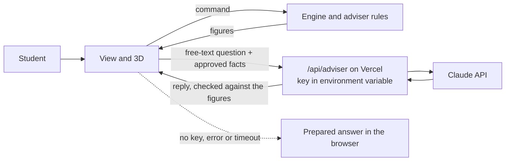

# G115 — Fra tomt til tak

Group project in **IBE160 Programming with AI** at Molde University College, autumn 2026 (15 ECTS credits).

This repository contains the group's application and the documentation of how it was developed, tested and quality-assured with AI.

## The project

*Fra tomt til tak* ("From plot to roof") is a 20-minute web simulator in which a newcomer runs a construction project as its project manager: an office building for 100 employees near the centre of Oslo, for a fictional client.

1. **Plan (the main part).** The student chooses the number of floors and the structural system, estimates the schedule, and chooses how to meet the known risks, with an AI adviser beside them.
2. **Execute.** The plan is put to the test. A few unforeseen events hit, and the student chooses a response. Each choice is compared with the AI's path from the same state.
3. **Debrief.** A budget bridge shows where the deviation came from, the decisions are ranked by how much they mattered, and a short conclusion ties the result to the learning goals.

### Why

Building projects run on average 32 % over schedule and 62 % over cost. Project management is usually taught through static artefacts, so learners rarely see how a plan breaks. Here the student's own plan is tested, which makes the consequences theirs.

## Status

The group chose this direction after comparing three proposals. **The planning is done; the new app is not built yet.** `FraTomtTilTak/app/` still contains the previous game (v0.5, *Regjeringskvartalet Light*), which is the starting point for the new app: the 3D world, Gantt view and icons are reused, while the engine is rewritten to follow the new simulation rules. The README will be updated as the stories are completed.

## Run locally

Requires [Node.js](https://nodejs.org/) 22.12 or newer. No API keys or accounts are needed.

```bash
cd FraTomtTilTak/app
npm install
npm run dev     # serves the app at http://localhost:5173
npm test        # runs the tests
npm run build   # type-checks and builds to dist/
```

The simulation engine is in `FraTomtTilTak/app/src/engine/` and has no UI code.

## Architecture at a glance

*The decided architecture for the new app; it is being built story by story. The full rules (AD-1 to AD-20) are in the [architecture document](FraTomtTilTak/planlegging/architecture/architecture-fra-tomt-til-tak-2026-11-05/ARCHITECTURE-SPINE.md).*

**Parts.** A static web app in TypeScript, built with Vite, with the 3D site in three.js. It runs entirely in the browser. The only server code is one small function on Vercel that calls Claude.

| Part | Folder | Does |
|---|---|---|
| Engine | `app/src/engine` | All figures: cost, time, risks, events, the AI path and the debrief. Pure and deterministic, so the same seed and choices always give the same result. |
| Adviser rules | `app/src/engine/adviser` | Suggestions, warnings and recommendations, computed by rules, never by the language model. |
| Content | `app/src/content` | Norwegian text and prepared answers, filled with figures from the engine. |
| AI layer | `app/src/ai` | Sends a free-text question to the server, checks the reply, and falls back to a prepared answer. |
| View | `app/src/ui` | Screens, Gantt chart and the 3D site. Holds the state and shows it. |
| Server function | `app/server` | Holds the Claude key and calls the Claude API. Nothing else. |

**Data flow.** The student's choice becomes a command. The command changes the one playthrough state, and the engine recalculates everything from that state. The view and the 3D site only read the state; they never change figures. Every choice is recorded in the decision log.

**Where Claude is called, and how the key is protected.** Only free-text questions to the adviser go to Claude (FR-17). The browser sends the question and the approved facts to `/api/adviser` on Vercel. The server function adds the key from a Vercel environment variable and calls Claude (`claude-sonnet-5-5`). The key is never in the repository or the browser; the repository has only `.env.example` without values. The function limits calls per playthrough and per IP address, and a spend limit on the Claude account is the hard cap. Before a reply is shown, every number in it is checked against the engine's figures; if one does not match, the reply is discarded.

**Without a key.** The whole game works with no key, no account and no server: suggestions and warnings are rules, and every question gets a prepared answer, marked *Forberedt svar*. This is the default locally and on Vercel previews. With a key, a failed or slow call (8 seconds) also falls back to a prepared answer.



## Folder structure

Everything for *Fra tomt til tak* is in one folder:

- `FraTomtTilTak/` — the project
  - `app/` — the application: source code (`src/`), icons (`assets/`) and build setup. Vercel builds from here.
  - `planlegging/` — the plans: brief, PRD, simulation rules, research, UX, architecture and `epics.md`
  - `implementering/` — stories and sprint status, created as the work starts
  - `G115_*.md` — the group's G115 files (changelog, dilemmas, final prompt, recommendations)
- `01. Admin/` — course material: the instructor's feedback on the brief
- `02. Arkiv/` — what *Fra tomt til tak* replaces, kept as a source of ideas: the earlier plans, the v0.x specs, and AI_BYGGplant with its agents (see its README)
- `_bmad/` — the BMAD framework, with its Claude Code skills in `.claude/skills/`
- `.logs/` — session logs per group member

## Planning documents

All in `FraTomtTilTak/planlegging/`:

- [Product brief](FraTomtTilTak/planlegging/briefs/brief-G115-tre-stadier-2026-10-29/brief.md)
- [PRD](FraTomtTilTak/planlegging/prds/prd-fra-tomt-til-tak-2026-10-31/prd.md), with [simulation rules and worked examples](FraTomtTilTak/planlegging/prds/prd-fra-tomt-til-tak-2026-10-31/simulation-rules.md)
- [Research: figures](FraTomtTilTak/planlegging/research/research-fra-tomt-til-tak-2026-10-31/research.md) and [research: reference projects](FraTomtTilTak/planlegging/research/research-referanseprosjekter-2026-10-31/research.md)
- [UX: EXPERIENCE.md](FraTomtTilTak/planlegging/ux-designs/ux-fra-tomt-til-tak-2026-10-31/EXPERIENCE.md) and [DESIGN.md](FraTomtTilTak/planlegging/ux-designs/ux-fra-tomt-til-tak-2026-10-31/DESIGN.md)
- [Architecture](FraTomtTilTak/planlegging/architecture/architecture-fra-tomt-til-tak-2026-11-05/ARCHITECTURE-SPINE.md)
- [Clickable demo of the proposal](FraTomtTilTak/planlegging/ux-designs/ux-fra-tomt-til-tak-2026-10-31/mockups/demo-fra-tomt-til-tak.html): download and open in a browser

### Earlier ideas

*Fra tomt til tak* replaces the earlier plans, but they hold ideas and data the group builds on. They are kept in `02. Arkiv/`, apart from the current documents so that nobody works on the wrong one:

- [Earlier product brief](02.%20Arkiv/planning-artifacts/briefs/brief-G115-2026-10-29/brief.md) (Regjeringskvartalet Light)
- [PRD for ByggAPP v0.5](02.%20Arkiv/planning-artifacts/prds/prd-G115-endregaard-haaseth-sandberg-2026-11-03/prd.md) and [PRD for AI_BYGGplant](02.%20Arkiv/planning-artifacts/prds/prd-AI_BYGGplant-2026-11-05/prd.md)
- The v0.5 game itself is kept as the git tag `v0.5`

Development follows the [BMAD framework](https://bmadcode.com/).

## Members

- Hedda R Endregaard
- Oskar Lia Haaseth
- Elisabeth Sandberg
- Trond Engelstad
